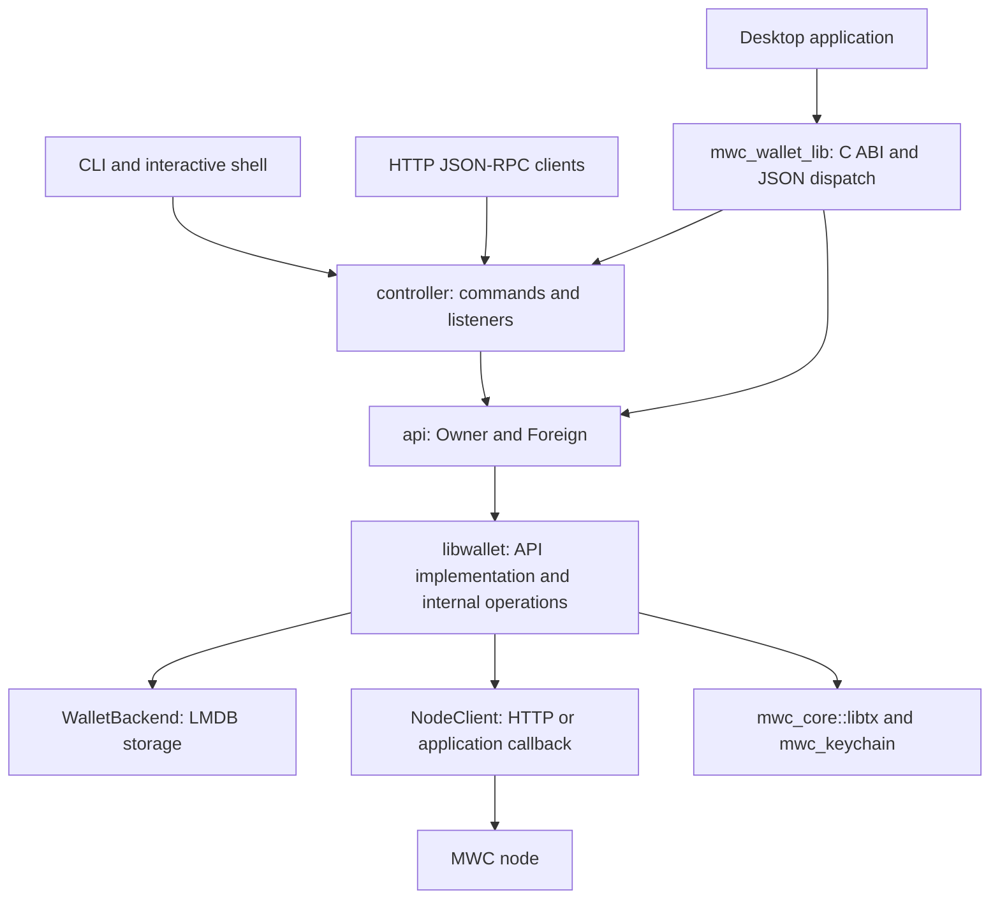

# Wallet implementation and workflow

Use this guide to find the code behind a wallet operation, choose an integration
point, and identify the relevant integration tests.

The wallet is a separate Cargo workspace from `mwc-node`. The CLI, HTTP APIs and
embedded C library share the wallet implementation. This checkout selects the
sibling `../mwc-node` through [util/Cargo.toml](../../util/Cargo.toml); the root
[Cargo.toml](../../Cargo.toml) also selects its Tor dependency patch. Keep those
dependency selections consistent when switching node revisions.

## High-level design

The main request paths are:



This shows the main transaction paths. Context setup and cleanup are shared
separately through `wallet_workflow`; some embedded queries call `libwallet`
helpers directly.

| Directory | Responsibility | Start reading here |
| --- | --- | --- |
| `src` | CLI definitions, argument parsing, command dispatch and interactive shell | [CLI options](../../src/bin/mwc-wallet.yml), [dispatch](../../src/cmd/wallet_args.rs), [shell](../../src/cli/cli.rs) |
| `config` | TOML settings, data paths and API-secret setup | [settings](../../config/src/types.rs), [configuration loading](../../config/src/config.rs) |
| `controller` | Command orchestration, HTTP/MQS listeners and their lifecycle | [commands](../../controller/src/command.rs), [listeners](../../controller/src/controller.rs) |
| `api` | Public Rust APIs and JSON-RPC interfaces | [Owner](../../api/src/owner.rs), [Foreign](../../api/src/foreign.rs) |
| `wallet_workflow` | Initialize and release context-scoped listeners, caches and runtime state | [context lifecycle](../../wallet_workflow/src/wallet.rs) |
| `mwc_wallet_lib` | C ABI, JSON method dispatch and callback-backed node access | [FFI entry point](../../mwc_wallet_lib/src/ffi.rs), [dispatcher](../../mwc_wallet_lib/src/mwc_wallet_calls.rs) |
| `libwallet` | Wallet traits, slates, transaction construction, scanning and coin selection | [traits](../../libwallet/src/types.rs), [API implementation](../../libwallet/src/api_impl), [internal operations](../../libwallet/src/internal) |
| `impls` | Concrete wallet, LMDB backend, seed handling, node client and transport adapters | [default wallet](../../impls/src/lib.rs), [LMDB](../../impls/src/backends/lmdb.rs), [lifecycle](../../impls/src/lifecycle/default.rs) |
| `util` | Shared utilities and re-exports of node and cryptography crates | [exports](../../util/src/lib.rs), [dependency selection](../../util/Cargo.toml) |

### Owner API, Foreign API and service controller

Choose the API according to who performs the operation:

| Caller | API | Examples |
| --- | --- | --- |
| Wallet owner | `Owner` | Inspect balances and transactions, create accounts, initiate/finalize transfers and post transactions |
| Transaction partner or mining node | `Foreign` | Receive a slate, finalize an invoice and build a coinbase |
| Rust application | Direct `Owner` / `Foreign` calls | Reuse wallet operations with a supplied backend and node client |
| Desktop application using C/C++ | `process_mwc_wallet_request` | Operate an initialized wallet context through JSON requests and callbacks |

The controller's `owner_single_use` and `foreign_single_use` helpers invoke
these Rust APIs. HTTP listeners expose them through JSON-RPC:

- [Owner RPC v2](../../api/src/owner_rpc_v2.rs): `/v2/owner`.
- [Owner RPC v3](../../api/src/owner_rpc_v3.rs): `/v3/owner`, with the
  `init_secure_api` exchange and encrypted requests.
- [Foreign RPC](../../api/src/foreign_rpc.rs): `/v2/foreign`.

The wallet owner listener binds to localhost. The foreign listener's socket
address and Tor behavior come from configuration and listener options.
Start and stop these services through
[controller.rs](../../controller/src/controller.rs); opening a wallet and
starting a listener are separate operations. See [setup](../setup.md),
[Tor transport](../tor_for_exchanges_pools.md) and [HTTP TLS](../tls-setup.md).

The wallet's foreign API accepts wallet-to-wallet and mining requests. Calls
from the wallet to a node use `NodeClient` and the node's API.

### Browser clients

A browser frontend can use the wallet owner API as its backend. Start the owner
listener explicitly and implement its authentication and, for v3, encryption
handshake. The [v3 client sample](../samples/v3_api_node/readme.md) demonstrates
the protocol.

Frontend assets and static-file hosting belong to the application integrating
the wallet. The wallet workspace supplies the API and listeners.

### Transaction library and slates

A [Slate](../../libwallet/src/slate.rs) carries the transaction data exchanged
between participants. The sender and recipient contribute outputs, commitments
and signatures in successive steps. Current send and invoice validation
implements a two-party exchange.

`libwallet` combines those exchanges with wallet state and coin selection.
Lower-level transaction building, range proofs and aggregate signatures come
from `mwc_wallet_util::mwc_core::libtx`, supplied by the selected node source.
Key derivation comes from `mwc_wallet_util::mwc_keychain`.

[Slatepack encoding](../../libwallet/src/slatepack) wraps the exchange data for
transport. See the [Slatepack format](../slatepack_data_format.md) for its
serialization and encryption details.

## Wallet traits and implementations

The generic parameters commonly used by wallet APIs are `L` for the lifecycle
provider, `C` for the node client and `K` for the keychain.
[libwallet/src/types.rs](../../libwallet/src/types.rs) defines the wallet traits:

| Trait | Responsibility | Current implementation |
| --- | --- | --- |
| `WalletInst` | Entry point to the wallet's lifecycle provider | `DefaultWalletImpl` in [impls/src/lib.rs](../../impls/src/lib.rs) |
| `WalletLCProvider` | Create, recover, open and close a wallet; provide its backend | `DefaultLCProvider` in [lifecycle/default.rs](../../impls/src/lifecycle/default.rs) |
| `WalletBackend` | Store outputs, transaction records, accounts and private transaction context | `LMDBBackend` in [backends/lmdb.rs](../../impls/src/backends/lmdb.rs) |
| `WalletOutputBatch` | Group backend writes into a transaction and commit them | LMDB batch implementation in the same backend file |
| `NodeClient` | Read chain data, check node transaction acceptance and publish transactions | HTTP, callback and test clients listed below |
| `Keychain` | Derive keys and commitments from the wallet seed and key paths | `ExtKeychain` from the node's `keychain` crate |

Accounts select parent derivation paths within the same wallet. The backend
records account mappings; the keychain derives the keys used for their outputs.
Seed encryption and password handling are implemented in
[lifecycle/seed.rs](../../impls/src/lifecycle/seed.rs).

Choose a node client for the environment:

- [HTTPNodeClient](../../impls/src/node_clients/http.rs) communicates with a
  node over HTTP JSON-RPC.
- [CallbackNodeClient](../../mwc_wallet_lib/src/callback_node_client.rs)
  delegates node requests to the embedding application. Qt can route them to
  an embedded node or a remote node.
- [LocalWalletClient and WalletProxy](../../impls/src/test_framework/testclient.rs)
  connect test wallets to a local test chain.

To add a node transport, implement `NodeClient` and preserve its connection,
cache and transaction-preflight contracts. Use the existing clients as examples.
Wallet-to-wallet transports are implemented separately in
[impls/src/adapters](../../impls/src/adapters).

## Lifetime and transaction flow

### 1. Initialize and open a wallet

1. Load [WalletConfig](../../config/src/types.rs) and allocate a context for the
   selected network. The CLI entry point is
   [src/bin/mwc-wallet.rs](../../src/bin/mwc-wallet.rs).
2. Initialize shared runtime state with `init_wallet_context`. A context
   identifies one wallet session through its complete lifetime.
3. Construct `DefaultWalletImpl` with a `NodeClient`, then use its lifecycle
   provider to select the wallet data directory and create, recover or open
   the wallet.
4. Select the account and construct the owner/foreign API wrappers needed by
   the caller.
5. Before releasing the context, finish outstanding direct calls.
   `release_wallet_context` stops and joins context-owned listeners before
   clearing their runtime state.

Keep one opened backend per wallet data directory. Wallet locks, slate
processing guards and reply caches coordinate requests through that backend.
The [lifecycle trait](../../libwallet/src/types.rs) describes this ownership
contract. The embedded API has an additional context registration sequence,
described below.

### 2. Trace a balance or output query

For a concrete example, follow the CLI `info` command:

1. [wallet_args.rs](../../src/cmd/wallet_args.rs) parses the command and calls
   `controller::command::info`.
2. [command.rs](../../controller/src/command.rs) calls
   `Owner::retrieve_summary_info` with node refresh enabled.
3. [api/src/owner.rs](../../api/src/owner.rs) delegates to
   `libwallet::api_impl::owner::retrieve_summary_info`.
4. [libwallet's owner implementation](../../libwallet/src/api_impl/owner.rs)
   refreshes wallet state from the node and computes the summary.
5. [display.rs](../../controller/src/display.rs) presents the result.

Inside an existing owner API call, the relevant call is:

```rust
// Refresh from the node and use a 10-confirmation threshold for the summary.
// owner_api and keychain_mask belong to the caller's open wallet session.
let (validated, summary) =
    owner_api.retrieve_summary_info(keychain_mask, true, 10)?;
```

The return value includes whether the node refresh succeeded. Use that flag when
presenting the summary: cached wallet data and a successful node refresh have
different meanings. Output queries also return the refresh anchor height so
confirmation counts can use the same chain snapshot as the retrieved outputs.

For scan or recovery behavior, continue into
[internal/scan.rs](../../libwallet/src/internal/scan.rs) and
[internal/updater.rs](../../libwallet/src/internal/updater.rs).
Creating a wallet from a recovery phrase prepares the local wallet; a subsequent
refreshing operation such as `info` performs the initial synchronization.

### 3. Trace a send, receive and finalize exchange

Start with `send`, `receive` and `finalize` in
[controller/src/command.rs](../../controller/src/command.rs). They coordinate
the exchange and persistence around the following operations:

| Stage | Main code | Result |
| --- | --- | --- |
| Initiate | `Owner::init_send_tx`, [selection.rs](../../libwallet/src/internal/selection.rs) and [tx.rs](../../libwallet/src/internal/tx.rs) | Apply amount, fee, confirmation and change-output options; construct the initial slate |
| Receive | `Foreign::receive_tx`, [foreign implementation](../../libwallet/src/api_impl/foreign.rs) | Validate the incoming slate and add the recipient's output and signature contribution |
| Finalize | `Owner::finalize_tx`, [owner implementation](../../libwallet/src/api_impl/owner.rs) | Validate the returned slate and complete the transaction; late locking selects/locks inputs at this stage |
| Post | `Owner::post_tx`, [transaction_preflight.rs](../../libwallet/src/transaction_preflight.rs), `NodeClient::post_tx` | Validate locally, run node preflight, then submit the finalized transaction |
| Refresh | `update_wallet_state`, scan and updater helpers | Reconcile confirmations, spent outputs and transaction records with the chain |

Online transports can perform the exchange in one command. File/Slatepack
workflows publish an initial slate, receive a response, and finalize in separate
commands. For selection options, see
[change outputs](../change_outputs.md).

Transaction persistence depends on the workflow. [TxSession](../../libwallet/src/types.rs)
stages private context, input reservations, outputs and transaction records.
Many online paths save it after a successful exchange or post; file workflows
must retain the state needed for a later response. When changing either path,
follow the existing ordering of publication, input locking and
`save_tx_data`. Its source documentation explains the failure and recovery
trade-offs, including an ambiguous transport error after remote acceptance.

A successful post acknowledges submission to the node. Subsequent wallet
updates establish whether the transaction was mined and how many confirmations
it has.

## Embedded desktop integration

Start with the [C header](../../mwc_wallet_lib/c_header/mwc_wallet_interface.h),
[FFI entry point](../../mwc_wallet_lib/src/ffi.rs) and
[JSON dispatcher](../../mwc_wallet_lib/src/mwc_wallet_calls.rs).

The application owns the following sequence:

1. Register the node-client callback and any required notification callbacks.
2. Call `init_wallet` with the configuration and retain the returned
   `context_id`.
3. For an existing wallet, call `open_wallet` with that context, its password
   and the registered `node_client_callback` name.
4. For a new or restored wallet, call `create_new_wallet` or
   `restore_new_wallet`, release that context, then initialize a new context
   with the same saved wallet path and open it.
5. Run wallet requests on application worker threads. Node callbacks return a
   JSON-RPC response synchronously; callbacks that update the UI must marshal
   those updates to the UI thread.
6. To shut down, stop submitting requests, request scan interruption if needed,
   and wait for outstanding direct calls. Then release the wallet context.
7. Unregister callbacks before freeing their caller-owned context. Unregistration
   waits for in-flight callbacks.

Each context registers at most one wallet instance. After closing a wallet or
a failed open attempt, release and reinitialize before opening again.
`close_wallet` closes the seed provider; `release_wallet` also removes the
registered wallet and releases the context.

`process_mwc_wallet_request` returns an allocated JSON string. Copy or parse it,
then release it with `free_lib_string`. Callback input strings are borrowed for
the duration of the callback. Keep node-callback response storage alive until
the library has copied it.

`stop_running_scan` requests interruption; the caller still waits for its scan
request to finish. Progress callbacks run inside the request and must return
promptly without synchronously re-entering wallet APIs or changing callback
registration.

Use the [C ABI specification](../mwc_lib_specification.md) for method parameters,
response schemas and complete ownership rules.

## Wallet integration tests

The controller tests provide complete examples using `LocalWalletClient` and
`WalletProxy`. Shared [test helpers](../../controller/tests/common/mod.rs)
create wallets, configure the local test chain and manage fixture data.

| Behavior | Test source |
| --- | --- |
| Send/receive/finalize and rollback | [transaction.rs](../../controller/tests/transaction.rs) |
| Late input locking | [late_lock.rs](../../controller/tests/late_lock.rs) |
| Slatepack exchange | [slatepack.rs](../../controller/tests/slatepack.rs) |
| Scan and recovery | [check.rs](../../controller/tests/check.rs) |
| Accounts and derivation paths | [accounts.rs](../../controller/tests/accounts.rs) |

These tests and their fixture APIs require the `test-support` feature. Tests
sharing the global wallet/node context run serially. Fixtures use directories
under `controller/test_output`.

## Related design material

The [PlantUML architecture](wallet-arch.puml) and its
[rendered image](wallet-arch.png) include the earlier browser/static-server
proposal. The [transaction diagram](../transaction/mwc-transaction-wf.png) and
[its source](../transaction/basic-transaction-wf.puml) illustrate the earlier
exchange design. Use the current code paths above for module boundaries,
supported participant flows, fees and lock-height behavior.
